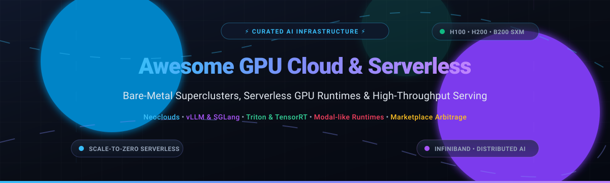

  

# 🚀 Awesome GPU Cloud & Serverless Infrastructure

> ⚡ A curated ecosystem of elite GPU cloud providers, serverless GPU inference platforms, bare-metal AI superclusters, and self-hosted open-source runtimes.

  
  
  
  
  

---

This curated directory tracks prominent **SaaS platforms** and **open-source systems** spanning the modern **GPU Cloud, AI Infrastructure, and Serverless GPU** computing ecosystem. These solutions provide instantaneous, on-demand access to high-performance NVIDIA GPUs (H100, H200, B200, GH200, A100, RTX 4090)—as raw bare-metal virtual machines, managed Kubernetes clusters, or scale-to-zero serverless runtimes—enabling machine learning engineers and developers to train, fine-tune, and serve models without datacenter management overhead. 🛠️✨

---

## 📑 Table of Contents

- [📊 Sector Overview & Market Dynamics](#-sector-overview--market-dynamics)
- [☁️ SaaS & Hosted GPU Platforms](#️-saas--hosted-gpu-platforms)
- [📦 Open-Source GitHub Projects](#-open-source-github-projects)
- [🏗️ Architectural Patterns & Recommendations](#️-architectural-patterns--recommendations)
- [⭐ Star History](#-star-history)
- [🤝 Support](#-support)
- [💡 How to Contribute](#-how-to-contribute)
- [⚠️ Disclaimer](#️-disclaimer)

---

## 📊 Sector Overview & Market Dynamics

The global **GPU-as-a-Service (GPUaaS)** and cloud GPU instance market is estimated at **$7.4B–$16B+ in 2026** and projected to exceed **$26.6B by 2030** (~26.5% CAGR), while the broader serverless AI computing sector is scaling beyond **$30B**. 🌐📈

The sector is currently **moderately fragmented with strong oligopolistic tendencies** among specialized neoclouds (CoreWeave, Crusoe, Nebius, Lambda) competing directly against hyperscalers (AWS, Azure, GCP); while bare-metal capacity faces raw commoditization pressures, serverless orchestration, low-latency cold-start networks, and dedicated high-speed InfiniBand/NVLink fabrics are creating high-barrier "winner-take-most" advantages in enterprise foundational model training and high-throughput real-time inference. 🏎️💨

---

## ☁️ SaaS & Hosted GPU Platforms

*Platforms are sorted in descending order by estimated company valuation / scale.* 🏢💰

| Platform | Company Valuation / Scale | Starting Tier Pricing | Free Tier / Trial Limit | Key Focus & Use Cases |
| :--- | :--- | :--- | :--- | :--- |
| **[Crusoe Cloud](https://www.crusoe.ai/cloud/pricing)** | 🌿 **$31.0 Billion** valuation ($2.0B ARR run-rate) | Starts from **$0.04/vCPU-hr** (CPU) and **$1.99/GPU-hr** (L40S / A100 spot); H100 SXM from **$3.95/hr** | **No standard public free tier/trial**; promotional pilot credits issued via enterprise application and federal/institutional research consortium grants | Clean-energy powered GPU infrastructure, InfiniBand multi-node training clusters, and managed inference fine-tuning without GPU lock-in. |
| **[FluidStack](https://www.fluidstack.io/)** | 💧 **$18.0 Billion** valuation (~$660M revenue run-rate) | Starts from **$0.50/hr** (RTX 4090), **$0.70/hr** (RTX A6000), **$0.95/hr** (A100 40GB), and **$2.50/hr** (H100 SXM on-demand; **$1.80/hr** reserved) | **No free tier or public trial**; enterprise-first direct card/invoice onboarding with custom proof-of-concept testing agreements | Ultra-low-cost, high-density GPU compute with free egress and 99.9% SLA across a global distributed datacenter network. |
| **[CoreWeave](https://www.coreweave.com/)** | ⚡ **~$12.0 Billion – $19.0 Billion+** valuation / public scale (~$7.6B TTM revenue) | Starts from **$6.50/hr** (1x GH200 single chip); Hopper/Blackwell nodes start at **$49.24/hr** (8x H100 node) and **$50,224/month** (8x B200) | **14-day trial window** with custom inference credits via the **CoreWeave ARENA Pass** for qualified teams (no permanent free tier; developer grant requests reviewed individually) | Massive-scale NVIDIA HGX H100/H200/B200 superclusters, InfiniBand interconnects, and Kubernetes-native infrastructure for tier-1 AI labs. |
| **[Together AI](https://www.together.ai/)** | 🤝 **$8.3 Billion** valuation (~$1.15B ARR run-rate) | Dedicated endpoints start from **$5.49/hr** (H100) and **$8.99/hr** (B200); GPU clusters from **$3.99/hr** on-demand (**$3.09/hr** reserved); Serverless inference from **$0.0001/1K tokens** | **No free tier**; requires an initial minimum prepaid credit deposit ($5.00–$15.00) to activate API usage; up to $50,000 via startup accelerator grants | Serverless token-based inference, dedicated high-throughput endpoints, and full-stack model fine-tuning environments. |
| **[Lambda](https://lambda.ai/)** | 🧠 **$5.9 Billion – $12.0 Billion** valuation target (~$1.5B revenue target) | Starts from **$2.79/hr** (8x A100 80GB per-GPU rate), **$3.99/hr** (8x H100 SXM), and **$4.29/hr** (1x H100 SXM on-demand) | **No public free tier or automated sign-up trial**; offers academic/open-source **Lambda Research Grants** with up to **$5,000 in cloud credits** | Bare-metal instances and 1-Click Clusters with NVIDIA Quantum-2 InfiniBand for consistent, unthrottled deep learning training runs. |
| **[Scaleway](https://www.scaleway.com/)** | 🇪🇺 **$4.0 Billion+** parent scale (Iliad Group subsidiary; €15M–€40M+ regional cloud segment revenue) | Starts from **€0.35/hr** (L4 GPU instances) up to **€2.90–€3.50/hr** (H100 PCIe/SXM nodes via Kubernetes pools) | **€100 free credit trial** for new business accounts; includes a permanent free tier for first 1,000,000 tokens on Generative AI API endpoints | European cloud ecosystem with sovereign EU data residency (GDPR-compliant), managed Kubernetes GPU pools, and serverless AI functions. |
| **[Voltage Park](https://voltagepark.com/)** | ⚡ **$2.5 Billion** valuation (merged with Lightning AI; $500M+ ARR) | Starts from **$1.99/hr** (NVIDIA H100 SXM on-demand without long-term commitment) | **No free tier on bare-metal H100s**; unified Lightning AI platform provides **22 free GPU compute credits/month** (free forever tier for developer sandbox exploration) | Accessible bare-metal H100 clusters integrated with Lightning AI developer environments for distributed model training. |
| **[Prime Intellect](https://app.primeintellect.ai/)** | 🌐 **$1.0 Billion** valuation (~$100M ARR) | Real-time aggregate spot rates from **$0.68/hr** (A100 spot), **$1.23/hr** (A100 on-demand), **$1.99/hr** (GH200), **$2.35/hr** (H100), and **$2.68/hr** (B200 spot) | **No automated public free tier**; provides **$500 to $100,000 in compute credits** through Fast Compute Grants and ~$2,000 partner startup vouchers | Decentralized multi-provider GPU marketplace enabling price aggregation, global compute bursting, and distributed training. |
| **[RunPod](https://www.runpod.io/)** | 🟣 **$1.0 Billion** valuation (~$240M ARR run-rate) | Starts from **$0.20/hr** (community GPU pods / RTX 3070), **$0.44/hr** (RTX 4090), and **$0.0002/sec** (~$0.72/hr) for serverless GPU workers | **$5 to $10 promotional starter credit** occasionally available via referral/partner signups; up to **$1,000 in free credits** via RunPod Startup Program | Developer-friendly serverless GPU inference, micro-VM execution, scale-to-zero workloads, and containerized development pods. |

---

## 📦 Open-Source GitHub Projects

*Curated open-source projects for self-hosted serverless GPU runtimes, high-throughput model serving engines, and orchestration frameworks, sorted by GitHub stargazers count (descending).* 🌟🛠️

| Project | Stars | Focus & Description |
| :--- | :--- | :--- |
| **[ollama/ollama](https://github.com/ollama/ollama)** |  | 🦙 Get up and running with large language models locally or on private GPU nodes with single-command setup and full OpenAI API compatibility. |
| **[ggerganov/llama.cpp](https://github.com/ggerganov/llama.cpp)** |  | ⚡ Ultra-efficient LLM inference in C/C++ with state-of-the-art quantization, mixed CPU/GPU offloading, and custom CUDA/Metal backends. |
| **[vllm-project/vllm](https://github.com/vllm-project/vllm)** |  | 🚀 High-throughput, low-latency LLM serving engine featuring PagedAttention, speculative decoding, continuous batching, and chunked prefill. |
| **[ray-project/ray](https://github.com/ray-project/ray)** |  | ☀️ Unified open-source compute framework for scaling AI and Python workloads—including distributed training, data preprocessing, and Ray Serve. |
| **[sgl-project/sglang](https://github.com/sgl-project/sglang)** |  | 🏎️ High-performance serving framework for large language models and vision-language models with RadixAttention for fast prefix caching and multi-turn KV reuse. |
| **[NVIDIA/TensorRT](https://github.com/NVIDIA/TensorRT)** |  | 🟢 High-performance deep learning inference optimizer and runtime compiler delivering microsecond latencies on NVIDIA GPUs. |
| **[triton-inference-server/server](https://github.com/triton-inference-server/server)** |  | 🔱 NVIDIA enterprise inference server providing standardized multi-framework model deployment (PyTorch, ONNX, TensorRT, vLLM) with dynamic batching. |
| **[skypilot-org/skypilot](https://github.com/skypilot-org/skypilot)** |  | ✈️ Multi-cloud framework for seamlessly orchestrating AI/ML training and inference across 8+ GPU clouds (Lambda, RunPod, AWS, GCP, Azure) with automatic cost minimization. |
| **[bentoml/BentoML](https://github.com/bentoml/BentoML)** |  | 🍱 Python framework for building reliable, production-ready AI services, custom compound AI systems, and containerized scale-to-zero GPU deployments. |
| **[kserve/kserve](https://github.com/kserve/kserve)** |  | ⛵ Standardized, Kubernetes-native serverless model serving with autoscaling, scale-to-zero, GPU resource scheduling, and canary rollouts. |
| **[beam-cloud/beta9](https://github.com/beam-cloud/beta9)** |  | 💡 Open-source Modal alternative for self-hosted serverless GPU compute—write Python/TypeScript decorators for inference, sandboxes, and checkpoint restore. |
| **[runpod/runpod-python](https://github.com/runpod/runpod-python)** |  | 🐍 Official open-source Python SDK and serverless worker runtime for deploying and automating serverless GPU endpoints on RunPod. |

---

## 🏗️ Architectural Patterns & Recommendations

- 🔄 **Serverless Scale-to-Zero Inference**: Use **[beam-cloud/beta9](https://github.com/beam-cloud/beta9)** or **[bentoml/BentoML](https://github.com/bentoml/BentoML)** for self-hosting serverless containers on your own Kubernetes cluster, or deploy to managed serverless workers on **[RunPod](https://www.runpod.io/)** / **[Together AI](https://www.together.ai/)**.
- 🚀 **Maximum Inference Throughput**: Standardize on **[vllm-project/vllm](https://github.com/vllm-project/vllm)** or **[sgl-project/sglang](https://github.com/sgl-project/sglang)** backed by **[triton-inference-server/server](https://github.com/triton-inference-server/server)** on bare-metal or reserved instances from **[Lambda](https://lambda.ai/)** or **[Nebius](https://nebius.com/)**.
- 🔀 **Multi-Cloud Arbitrage & Fallback**: Run **[skypilot-org/skypilot](https://github.com/skypilot-org/skypilot)** to burst workloads across disparate providers or compare live bidding prices using **[Prime Intellect](https://app.primeintellect.ai/)**.
- 🌐 **Ultra-Scale Distributed Training**: Reserve dedicated NVIDIA Quantum-2 InfiniBand HGX clusters on **[CoreWeave](https://www.coreweave.com/)**, **[Crusoe Cloud](https://www.crusoe.ai/)**, or **[Lambda](https://lambda.ai/)** to eliminate multi-node communication bottlenecks.

---

##  Star History

---

## 🤝 Support

Thank you so much for exploring and supporting **Awesome GPU Cloud & Serverless Infrastructure**! ❤️

If you find this repository valuable:
- ⭐ **Star** this repository on GitHub to help others discover it.
- 🍴 **Fork** it and submit a pull request with new providers, frameworks, and benchmarks.
- 📢 **Share** it with your network, AI infrastructure teammates, and ML engineering peers.
- ☕ **Buy me a coffee**: If you'd like to support continued maintenance and curation of open AI infrastructure tooling, you can sponsor through the [GitHub Sponsors Dashboard](https://github.com/sponsors/ishandutta2007). Your support is greatly appreciated!

---

## 💡 How to Contribute

Contributions are welcome! Help keep this ecosystem tracker accurate, objective, and up to date: 🤝✨

1. Fork the repository.
2. Add or update entries in `README.md` following the tabular format and guidelines:
   - Provide exact pricing tiers and verified free tier / credit terms.
   - For open-source projects, include the repository URL and descriptive summary.
3. Submit a pull request with a concise description of your changes.

---

## ⚠️ Disclaimer

- This is a **community-curated** list for informational purposes.
- Cloud GPU pricing and promotional credit availability fluctuate frequently; please verify current rates and quotas directly with providers prior to production commitments.
- Certain high-end instances (such as NVIDIA HGX Hopper H100/H200 and Blackwell B200) enforce minimum rental allocations (e.g., full 8-GPU nodes).
# Awesome-GPU-Cloud-Serverless-Infrastructure

